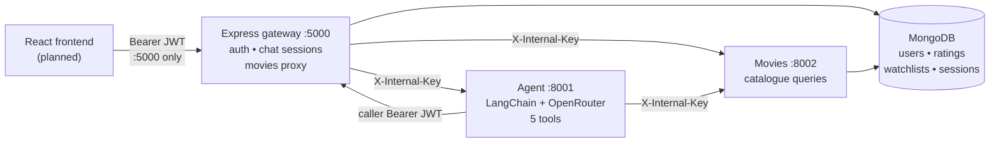

# CineMind Architecture

## Request flows

**Browse**: Browser → `GET :5000/api/movies*` → proxy (allowlist-checked,
timeout `MOVIES_TIMEOUT_MS`) → `:8002` → MongoDB. Browser never touches
`:8002` directly.

**Chat**: Browser → `POST :5000/api/chat/sessions/:id/messages` (Bearer,
owner-checked) → Express persists the user message → `POST :8001/chat`
`{message, limit, user_token}` with `X-Internal-Key` (timeout
`AGENT_TIMEOUT_MS`) → agent uses catalogue tools via `:8002` and personal
tools via Express user endpoints (caller JWT) → Express resolves
`movie_ids` to validated cards via `:8002/movies/{id}`, persists the reply,
returns `{sessionId, reply, movies}`.

## Auth boundaries

- Public internet: `:5000` only. `:8001`/`:8002` are reachable only inside
  the deployment network (no Docker Compose is shipped yet — see
  `KNOWN_LIMITATIONS.md`; until then, bind them to localhost).
- Internal: `X-Internal-Key` on agent `/chat` and every server-to-service
  call. User data: Bearer JWT, ownership scoped per query.
- Abuse controls: Express rate limits (auth 30/15min, chat 30/min),
  FastAPI middleware (movies 300/min, agent 60/min, `/health` exempt),
  input validation at every boundary, error envelopes without internals.

## Data

- Catalogue: `tmdb_top1000_movies.csv` (1000 rows, 24 cols) → `movies`
  collection, upserted on unique `tmdb_id` (repeatable, never deletes).
  Indexes: unique `tmdb_id`, `title`, `year`, `genres`, text search.
- App data: `users` (bcrypt/scrypt hashes only), `ratings` (1–10),
  `watchlists`, `chatsessions` + `chatmessages` (user/assistant, movieIds).
